# SecureShare

[](LICENSE)
[](docker-compose.yml)
[](frontend/)
[](services/crypto-service/)
[](services/storage-service/)

**SecureShare** is an end-to-end encrypted file sharing app. Files are encrypted in your browser before upload. The server only stores scrambled data. You control who can download each file.

**Repository:** [github.com/fujai2004/SecureShare](https://github.com/fujai2004/SecureShare)

---

## Features

- **Client-side encryption** using AES-256-GCM (Web Crypto API)
- **User accounts** with JWT authentication (Argon2 password hashing)
- **Per-file access control** share with other users by username
- **Multithreaded storage service** (C++) for encrypted chunk storage
- **Rust control plane** for auth, ACLs, and storage orchestration
- **Kubernetes manifests** with per-tenant namespace templates
- **Fault injection tests** for storage reliability

---

## How it works

```mermaid
flowchart TB
  subgraph browser [Your browser]
    UI[React UI]
    ENC[Encrypt / decrypt]
  end

  subgraph rust [crypto-service]
    AUTH[Auth + JWT]
    ACL[Access control]
  end

  subgraph cpp [storage-service]
    STORE[Chunk store]
  end

  UI --> ENC
  ENC -->|ciphertext only| AUTH
  AUTH --> ACL
  AUTH --> STORE
```



| Layer | Tech | Role |
|-------|------|------|
| `frontend/` | React, TypeScript, Vite | UI, encrypt/decrypt in browser |
| `services/crypto-service/` | Rust, Axum | Login, file metadata, ACL grants |
| `services/storage-service/` | C++20 | Store and serve encrypted chunks |
| `deploy/k8s/` | Kubernetes | Deploy services, tenant isolation |

---

## Quick start

### Prerequisites

- [Docker Desktop](https://www.docker.com/products/docker-desktop/) (recommended)

Optional for native development:

- Node.js 20+
- Rust 1.85+
- CMake 3.20+ and a C++20 compiler (Linux/WSL for storage service)

### Run with Docker

```bash
git clone https://github.com/fujai2004/SecureShare.git
cd SecureShare
docker compose up --build
```

| Service | URL |
|---------|-----|
| **Web app** | http://localhost:5173 |
| Crypto API | http://localhost:8080/health |
| Storage API | http://localhost:9000/health |

### Try the app

1. Open http://localhost:5173 and **Create account**
2. **Upload** a file (encrypted before it leaves your browser)
3. **Share** with another user: create a second account in an incognito window, then grant access by username
4. Tell the recipient your **password** separately so they can decrypt the file

> **Important:** Your account password is also the encryption key. If you forget it, encrypted files cannot be recovered.

---

## Project structure

```
SecureShare/
├── frontend/                 # React web app
├── services/
│   ├── crypto-service/       # Rust API (auth, ACL, uploads)
│   └── storage-service/      # C++ chunk store
├── deploy/k8s/               # Kubernetes base + tenant templates
├── tests/fault-injection/    # Reliability tests
└── docker-compose.yml        # Local full stack
```

---

## Development

### Rebuild after changes

```bash
docker compose up --build
```

Frontend only:

```bash
docker compose up --build frontend
```

### Native frontend (hot reload)

```bash
docker compose up storage-service crypto-service
cd frontend && npm install && npm run dev
```

### Run tests

```bash
# Storage fault injection (storage-service must be running)
cd tests/fault-injection
cargo test
```

See [CONTRIBUTING.md](CONTRIBUTING.md) for more development notes.

---

## Deploy to Kubernetes

```bash
kubectl apply -k deploy/k8s/base
```

Per-user tenant namespaces: [deploy/k8s/README.md](deploy/k8s/README.md)

Set a strong `JWT_SECRET` in production (see `deploy/k8s/base/secrets.yaml`).

---

## Security model

1. **Client-side encryption:** Plaintext never leaves the browser unencrypted.
2. **ACL at the API:** Only authorized users can list or download a file.
3. **Opaque storage:** The C++ service stores ciphertext chunks only.
4. **Tenant isolation (K8s):** Optional per-user namespaces and network policies.

This is a **portfolio / learning project**, not a production-hardened security product. Do not use it for highly sensitive data without a professional security review.

---

## Tech stack

| Area | Technologies |
|------|----------------|
| Frontend | React 18, TypeScript, Vite |
| API | Rust, Axum, JWT, Argon2 |
| Storage | C++20, CMake, pthreads |
| Ops | Docker Compose, Kubernetes |

---

## License

MIT License. See [LICENSE](LICENSE).

---

## Author

**[fujai2004](https://github.com/fujai2004)** on GitHub
