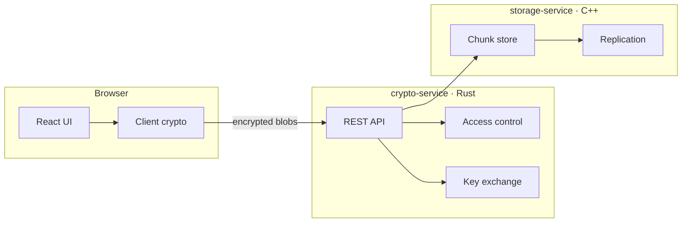

# SecureShare

End-to-end encrypted distributed file sharing. Files are encrypted client-side with **AES-256-GCM** before upload; keys are exchanged via an authenticated control plane; storage and replication run in isolated per-user Kubernetes namespaces.

## Architecture



| Component | Stack | Responsibility |
|---|---|---|
| `frontend/` | React, TypeScript, Vite | Upload/download UI, local encrypt/decrypt, session management |
| `services/crypto-service/` | Rust, Axum | Users, ACLs, authenticated key material, JWT |
| `services/storage-service/` | C++20, CMake | Multithreaded chunk storage, replication hooks |
| `deploy/k8s/` | Kubernetes | Per-user namespaces, network policies, deployments |

## Quick Start (Local)

**Prerequisites:** Docker, Node 20+, Rust 1.78+, CMake 3.20+, a C++20 compiler.

```bash
docker compose up -d
cd frontend && npm install && npm run dev
cd services/crypto-service && cargo run
# Build storage-service separately; see services/storage-service/README.md
```

| Service | URL |
|---|---|
| Frontend | http://localhost:5173 |
| Crypto API | http://localhost:8080 |
| Storage API | http://localhost:9000 |

## Security Model

1. **Client-side encryption:** Plaintext never leaves the browser unencrypted; the storage service only sees ciphertext chunks.
2. **Authenticated key exchange:** Users prove identity to the crypto service; file keys are wrapped per recipient (see `crypto-service` docs).
3. **Service boundary ACLs:** Every storage operation carries a capability token validated by the crypto service.
4. **Tenant isolation:** Kubernetes assigns each user a dedicated namespace with a `NetworkPolicy` denying cross-namespace traffic.

## Testing

```bash
cd tests/fault-injection
cargo test
```

Simulates node failures and concurrent writes; asserts no acknowledged write is lost.

## Deploy to Kubernetes

```bash
kubectl apply -k deploy/k8s/base
```

See [deploy/k8s/README.md](deploy/k8s/README.md) for per-user namespace provisioning.

## License

MIT
